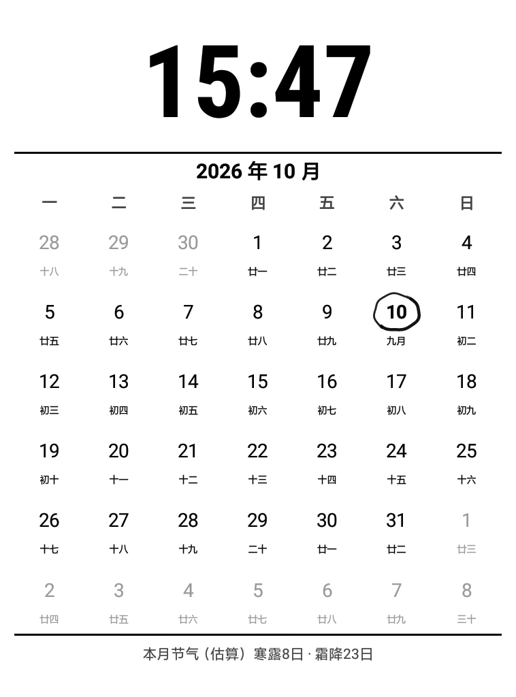
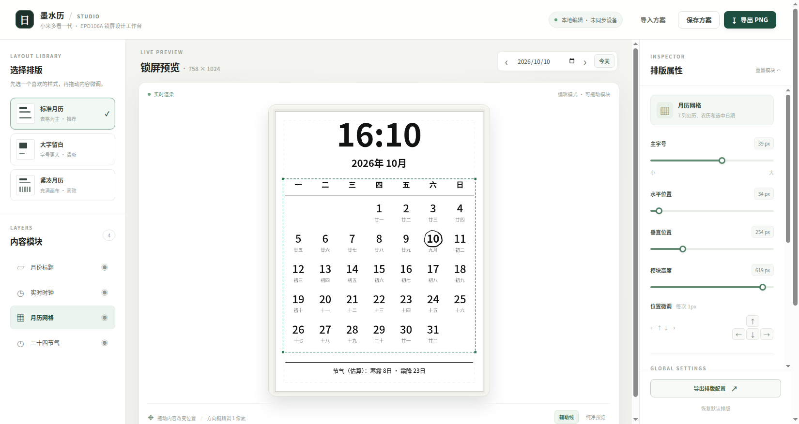

# 墨水历 · EPD106A 动态万年历锁屏

[English](README.en.md) · [2026-10-14 电源键与 1/10 分钟 RTC 修复](docs/POWERKEY_RTC_REFRESH_20261014.md) · [10 分钟低功耗 RTC 实验](docs/TEN_MINUTE_RTC_EXPERIMENT.md) · [自动息屏进入实时日历](docs/AUTO_IDLE_LIVE_CALENDAR.md) · [当前系统备份与复制到第二台](docs/SAME_DEVICE_RESTORE.md) · [安装与卸载](docs/INSTALL.md) · [工程/产品验收](docs/ACCEPTANCE.md) · [恢复机制](docs/RECOVERY.md) · [已遇到的问题](docs/TROUBLESHOOTING.md) · [Root 与版权](docs/ROOT_AND_LICENSES.md)

为小米多看阅读器一代、墨案 EPD106A / Android 8.1（virgo-perf1）开发的**开源、原生、真实分钟更新的动态万年历**。本项目不是静态锁屏 PNG：在正常电量下，短按实体电源键直接切换至原生 Android 日历，显示北京时间 `HH:mm`、公历、农历、月历和节气估算、今日手绘墨圈；再次短按返回原阅读任务。

**2026-10-14 刷新优化（源码版 0.3.1）**：将“实体电源键进入”和“自动息屏进入”统一接入 RTC 定时唤醒→更新→再次休眠流程。启用 `persist.epd.tenmin=1` 后，默认 10 分钟刷新；设置 `persist.epd.clock.interval=1` 可选择每分钟刷新。两种模式都不持续保持 `KEEP_SCREEN_ON`，分钟更新只改动变化的时钟文本；固件 DU 局刷是否完全无闪烁、断电续航改善幅度仍需实测。详见 [功能与验收](docs/POWERKEY_RTC_REFRESH_20261014.md)。**注意：旧 GitHub Release APK 不自动包含这次源码更新，须构建新版双 APK 并部署。**

**自动息屏修复（EPD106A）**：系统空闲超时现在也会显示同一个实时日历，而不再使用墨案静态壁纸。NeatReader 阅读页原有的 `KEEP_SCREEN_ON` 会在启用自动日历时暂时移除，以允许系统超时生效；同时跳过墨案厂商在此次自动超时切换中多余的 `showSuspendLogo()` 静态壁纸窗口，避免旧截图短暂盖到日历上。由于屏幕必须保持通电才能分钟刷新，此功能**比真正的静态休眠耗电**，低电量时自动恢复原厂待机。技术及关闭方式详见 [自动息屏说明](docs/AUTO_IDLE_LIVE_CALENDAR.md)。

设备原生界面（实机截屏）：



网页版排版工具（独立，不会自动同步设备）：



## 最短安装路径

**先阅读 [安装说明](docs/INSTALL.md)。系统级电源键挂接具有启动风险，请先做好 Recovery 回退准备。**

1. Android 8.1 EPD106A 安装最新版 Magisk 并启用 Zygisk；通过其官方渠道安装兼容的 LSPosed（第三方软件，**本仓库不分发**）。
2. 下载本仓库 Releases 中的 `eink-calendar.apk` 和 `eink-livecalendar-policy.apk`，依次安装。
3. 在 LSPosed 管理器中启用 **墨水万年历 · 电源键模块**（org.epd.calendar.policy），**仅**将范围设为 Android Framework（`system`），重启。
4. 先测试能正常启动，再从 Ubuntu 执行 `scripts/enable.sh` 打开功能；需要真实睡眠的 RTC 刷新时另执行 `scripts/enable-tenmin.sh`，使用 `./set-refresh-interval.sh 10` 或 `1` 选择刷新间隔。按模式跨越对应时间边界检查刷新和休眠，最后测试退出返回阅读任务。
5. 随时可运行 `scripts/disable.sh` 关闭挂接逻辑；无法启动时参见 [Recovery 救援](docs/RECOVERY.md)。

```bash
# 方式 A：源码构建
bash build.sh && bash build-xposed.sh
# 方式 B：下载 GitHub Release 两份 APK 至 dist/（无需源码构建）
# 最后都使用同一个安装入口
bash scripts/install.sh
# 必须先在 LSPosed 设好 system 范围并重启
bash scripts/enable.sh
bash scripts/status.sh
# 紧急停止（不会删除书籍）
bash scripts/disable.sh
```

构建需要 Ubuntu、JDK 8+、Android SDK platform android-36 和 build-tools 35.0.0；建议使用项目锁定的 API/构建工具版本。SDK 路径来自 `ANDROID_HOME` 或 `~/Android/Sdk`。

## 工作原理

```text
/dev/input/event1 实体 POWER（内核/系统仍由原厂驱动处理）
 → Android PhoneWindowManager.powerPress(long, boolean, int)
 → LSPosed 极小范围 hook（需用户明确开启）
    → 原生 org.epd.calendar/.MainActivity
      → 使用 Android Handler 每分钟整点更新 + 墨水屏固件 DU 局刷
    → 再次短按通过定向广播退出，恢复上一任务
```

只在普通单击、可交互且用户显式开启时切换，长按及多击保持原厂逻辑。旧常亮模式在显示层 ON 时按分钟重绘；**RTC 模式不是持续运行的 AOD**，而是周期性唤醒屏幕并在绘制后重新休眠，实际频次由 `persist.epd.clock.interval` 控制。两种机制耗电不同，且 RTC 分钟模式明显比 RTC 十分钟模式唤醒更频繁。未接电且电量低于 30% 时不进入动态日历，日历内低于或等于 25% 时自动退出。这个阈值设定是设备保护，不能代替实际续航测量。

网页工作台 `web/index.html` 只用于排版和静态 PNG/JSON 导出，**不会更改安装在阅读器上的原生 UI**。运行：`cd web && python3 -m http.server 8786 --bind 127.0.0.1`，访问 http://127.0.0.1:8786 。

## 兼容性与限制

- **仅 EPD106A / Android 8.1 实机验证**；不要在其他设备盲目启用 system_server hook。
- 节气使用近似公式，极少数日期可能有一天偏差；农历依赖设备 ICU。
- 第三方 LSPosed、Magisk、厂商系统不是本项目的一部分。
- 自助 Recovery 回退经过“写入 /cache”和“开机禁用空模块”两段真实测试，**未在真实不可启动故障上演练**；不可宣称 100% 可救援。
- 系统分区镜像、官方固件、专有 APK、私人备份、密钥和书籍内容均**未随仓库发布**。
- 如发现异常，优先执行 `scripts/disable.sh`，不要尝试底层按键 EVIOCGRAB。

## 测试和发布

```bash
bash build.sh
bash build-xposed.sh
python3 -m unittest discover -s tests -v
# 可选网页浏览器功能测试：需要 Chrome、Pillow、websockets
# 另开终端: python3 -m http.server 8786 --bind 127.0.0.1 --directory web
python3 web/test_web_ui.py
bash scripts/test-device.sh               # 只读检查
bash scripts/test-device.sh --power-cycle  # 需要人工同意，改变当前页面
```

完整工程/产品验收、测试日志和待办见 [docs/ACCEPTANCE.md](docs/ACCEPTANCE.md)。本仓库第一方代码采用 [Apache-2.0](LICENSE) 协议；商标属于各自所有者，非厂商或第三方项目官方产品。

## NeatReader + 墨案系统栏联动触控（EPD106A 专用）

在 NeatReader 阅读页**轻点正中间**，一次操作同时显示两套原生界面：**NeatReader** 顶部返回／书签／搜索、底部阅读进度及「目录／笔记／书签／设置」，以及**墨案系统顶部栏**的主页（小房子）／后退／Wi-Fi／电量。再次轻点正中间，恢复阅读全屏。**不使用自制按钮，也不展开会遮住全页的通知面板。**

左右区域翻页仍由 NeatReader 原生处理；中央滑动、多点触控和长按按原坐标交回阅读视图。模块仅在包 `com.gzhi.neatreader.r2.main` 的 `BookReaderActivity` 附加中央透明触控区，复用 `ll_layer_top`、`ll_layer_bot` 并临时调整该 Activity 的系统栏可见性；离开页面会恢复原窗口状态。不会修改多看、固件或全局系统栏。

首次使用：安装 `eink-neat-touchzones.apk`，在 LSPosed 中只选择 **Neat Reader**（不能选择 Android Framework 或多看），随后重启 NeatReader 应用。在 Ubuntu 执行：

```bash
adb shell 'su -c "resetprop persist.epd.neatzones 1"'
# 如果 NeatReader 出现异常，立即停用，仅停用这项触控修改：
adb shell 'su -c "resetprop persist.epd.neatzones 0"'
adb shell am force-stop com.gzhi.neatreader.r2.main
```

**限制：** 可选的墨水屏 DU 快刷尚未纳入这个触控修复，它无法保证解决 NeatReader 原本的加载转圈和整屏刷新。未在实际 20 次以上连续翻页或大批量书籍上验证；不要将菜单成功等同于全局流畅度达标。
